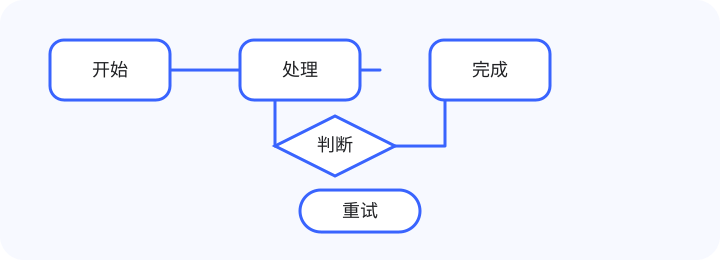

# DSH Fence Code Renderer

English | [中文](README.zh.md)

Render diagram code fences as theme-aware SVGs in [DeepSeek Harness](https://github.com/deepseek-ai/deepseek-harness) conversations. The plugin extends DSH's Markdown fence slot while keeping its built-in Markdown renderer.

## Features

- **Multiple diagram types**: flowcharts, sequence diagrams, UML class diagrams, state diagrams, ER diagrams, and PlantUML component and use-case diagrams.
- **Mermaid and PlantUML fences**: supports `flowchart`, `graph`, `mermaid`, `plantuml`, `puml`, and `uml` code fences.
- **Safe rendering**: creates SVG with React elements instead of injecting diagram HTML.
- **Readable fallback**: keeps streaming fences as code blocks and returns to the original DSH code block when syntax is unsupported, invalid, or too complex.

## Preview

[](docs/preview.svg)

## Install

Requires DSH `>=0.2.2-rc.3 <0.3.0`. This repository is a local plugin project; its package is private and is not published to npm.

```sh
git clone https://github.com/dingyiliao/dsh-plugin-fence-code-renderer.git
cd dsh-plugin-fence-code-renderer
npm run build
```

In DSH Web, open **Plugins → Add plugin** and select the cloned project directory. Then start or reopen a conversation to use the renderer.

For example, send this Markdown fence:

````markdown
```flowchart TD
  Start[Start] --> Check{Success?}
  Check -->|Yes| Done[Done]
  Check -->|No| Retry((Retry))
```
````

## Supported syntax

- **Flowcharts**: `TD`, `TB`, `BT`, `LR`, and `RL` layouts; common Mermaid node shapes and edge styles; edge labels; fan-in and fan-out; nested subgraphs; and CJK-aware text wrapping.
- **Sequence diagrams**: Mermaid `sequenceDiagram` and PlantUML `@startuml`; participants, actors, databases, activations, fragments, self-calls, notes, and dividers.
- **Class diagrams**: Mermaid `classDiagram` and PlantUML classes, interfaces, enums, members, packages, inheritance, implementation, composition, aggregation, association, and dependency.
- **State and ER diagrams**: Mermaid `stateDiagram`, `stateDiagram-v2`, and `erDiagram`, including start and end states, composite states, choice/fork/join markers, entity fields, and cardinalities.
- **PlantUML component and use-case diagrams**: common components, actors, databases, packages, and relationships.

The renderer supports a practical subset of Mermaid and PlantUML. Gantt charts, pie charts, mind maps, `!include` macros, and activity-diagram swimlanes fall back to DSH's original code block.

## Architecture

`src/diagram-dispatcher.mjs` selects a parser and returns a layout model. The flowchart, sequence, and UML modules in `src/` parse and lay out diagrams; `src/client-template.js` renders the result as SVG. `build.mjs` assembles these modules into the `client.js` loaded by DSH. The plugin entry point and loader patch are `index.js` and `cordis.patch.yml`.

## Development

```sh
npm run build
npm test
npm run check
```

The plugin only handles code fences in DSH Chat View. It leaves ordinary Markdown, math, diffs, and file links to DSH. Rendered diagrams do not currently support dragging, zooming, or clickable interactions; keep the original fence when you need to copy or edit its source.
